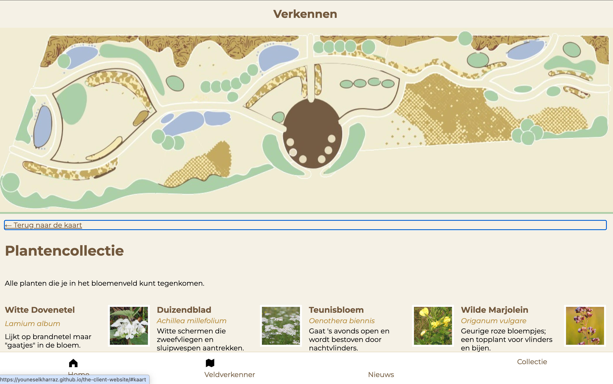
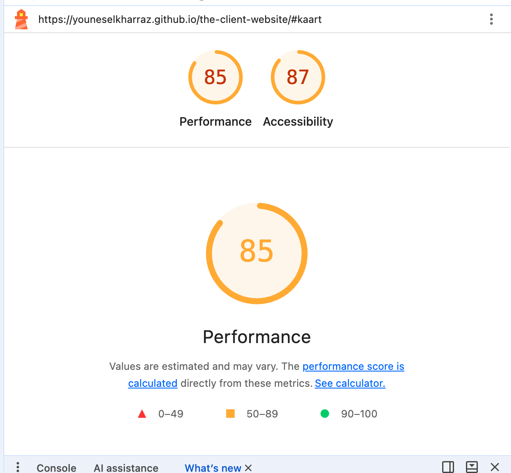

# WCAG Audit 

Doe een WCAG audit op een bestaande website uit je eigen omgeving en rapporteer daarover.

De instructies van deze opdracht staan in [WIKI](https://github.com/fdnd-task/wcag-audit/wiki).

## Veldverkenner – Bloemenveld Frankendael

Ik heb mijn eigen website getest: de **Veldverkenner** voor Bloemenveld Frankendael: [youneselkharraz.github.io/the-client-website](https://youneselkharraz.github.io/the-client-website/). Het is een mobiele webapp voor een bloemenveld in Park Frankendael (Amsterdam-Oost). Bezoekers kunnen er de kaart van het bloemenveld bekijken en in de plantencollectie zien welke planten er staan.

### Lighthouse Accessibility

Lighthouse (in Chrome DevTools) geeft de pagina **87** voor Toegankelijkheid en **85** voor Performance.

### Samenvatting van de testbevindingen

De pagina is op veel punten goed toegankelijk: alle afbeeldingen hebben een alt-tekst, de taal is goed ingesteld (`lang="nl"`), de tabvolgorde klopt en elke link heeft een zichtbare focus.

De belangrijkste problemen:

1. **Te laag contrast** (WCAG 1.4.3): de Latijnse plantnamen en de kop "Alle planten" halen 2,80 : 1. Nodig is 4,5 : 1.
2. **Kapotte links** in het menu: "Home" en "Nieuws" geven een 404.
3. **Overgeslagen kopniveau** (WCAG 1.3.1): na de h1 komen meteen h3-koppen.
4. **De titel "Verkennen"** staat alleen in de CSS en is geen echte kop.
5. **De alt-tekst van de kaart** is erg kort en zegt niet wat er op de kaart staat (WCAG 1.1.1).

De volledige documentatie met alle tests, screenshots en verbeterpunten staat hier: [WCAG-audit van de Veldverkenner](wiki/WCAG-audit-van-de-Veldverkenner.md).

## Licentie

This project is licensed under the terms of the [MIT license](./LICENSE).
