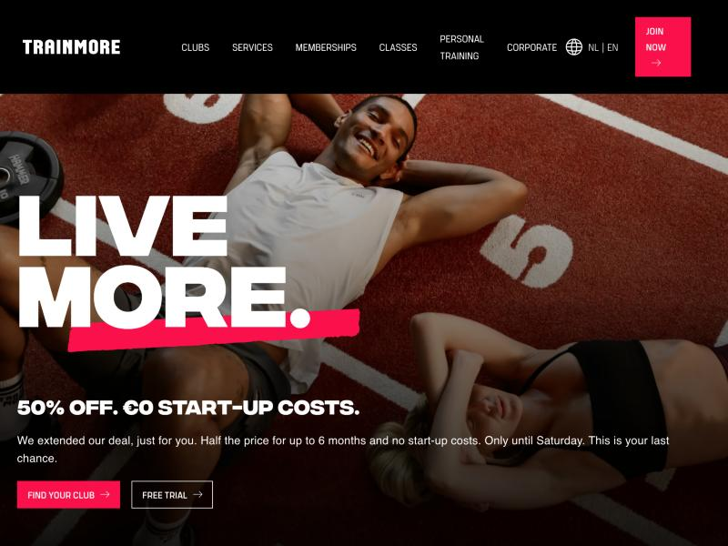
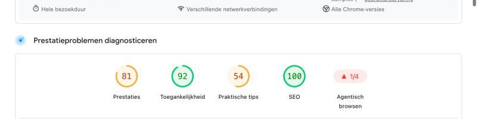

# WCAG Audit 

Doe een WCAG audit op een bestaande website uit je eigen omgeving en rapporteer daarover.

De instructies van deze opdracht staan in [WIKI](https://github.com/fdnd-task/wcag-audit/wiki).

## TrainMore

Ik heb de website van sportschool **TrainMore** getest: [trainmore.com/en-NL](https://trainmore.com/en-NL/). Het is de website van een sportketen met clubs in onder andere Amsterdam, Den Haag en Utrecht. Bezoekers kunnen er een lidmaatschap afsluiten, een gratis proefles aanvragen en clubs en lessen bekijken. Ik heb de homepage in de Engelse versie getest.

### Lighthouse Accessibility

Lighthouse (versie 13.6.0, via PageSpeed Insights, desktop) geeft de homepage **92** voor Toegankelijkheid.

### Samenvatting van de testbevindingen

De homepage is op veel punten goed toegankelijk: alle afbeeldingen hebben een alt-tekst, de koppen staan in een logische volgorde, de tabvolgorde van het menu klopt en de menulinks hebben een zichtbare focus.

De belangrijkste problemen:

1. **Te laag contrast** (WCAG 1.4.3): de footerlinks halen 2,49 : 1 en de rode knoppen "Join now" en "Find your club" 4,01 : 1. Nodig is 4,5 : 1.
2. **Knoppen zonder naam** (WCAG 4.1.2): onder andere de pijlknoppen van de carrousel hebben geen tekst.
3. **Geen duidelijke focusrand** bij de knop "Join now" (WCAG 2.4.7).
4. **Geen skip-link** om het menu over te slaan (WCAG 2.4.1).
5. **Alt-teksten** die een bestandsnaam zijn, zoals `NexLevelClasses_desktop.webp` (WCAG 1.1.1).

De volledige documentatie met alle tests, screenshots en verbeterpunten staat in mijn Wiki: [WCAG-audit van TrainMore](https://github.com/Youneselkharraz/wcag-audit/wiki).

## Licentie

This project is licensed under the terms of the [MIT license](./LICENSE).
