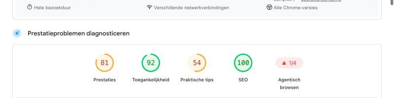
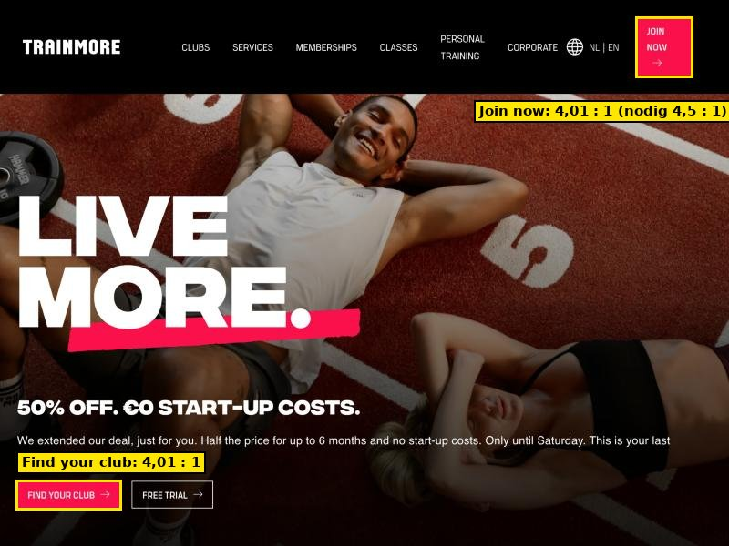
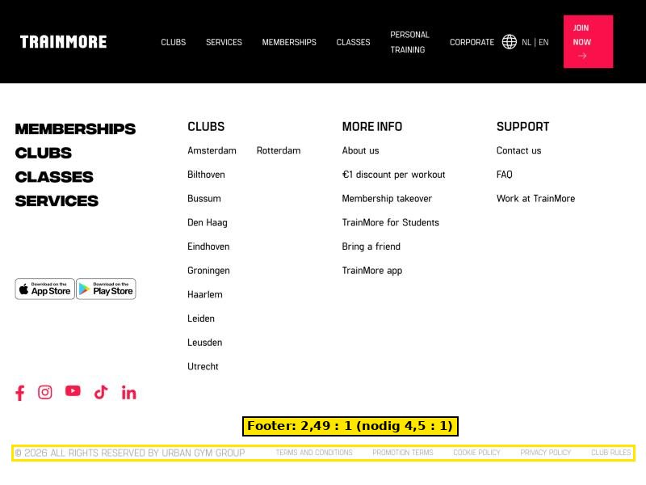
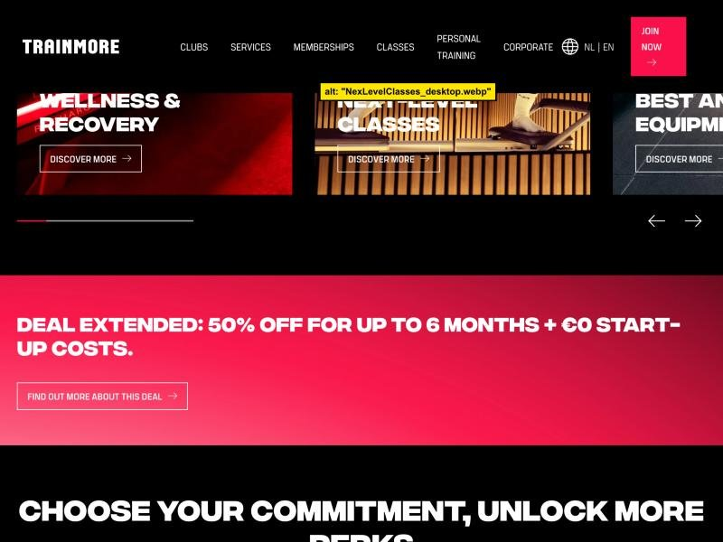
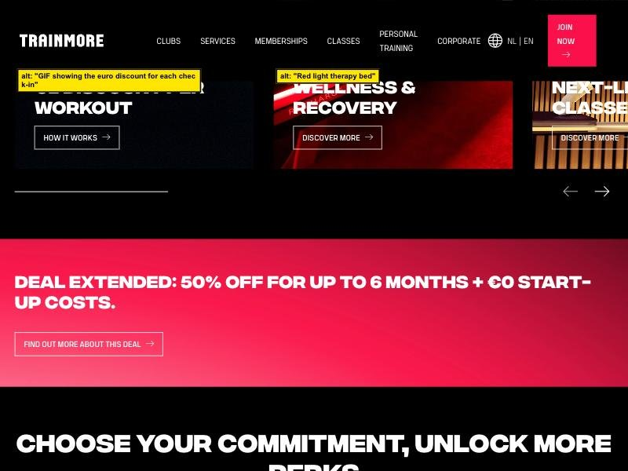
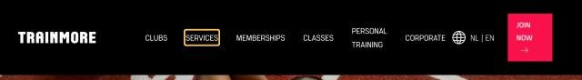
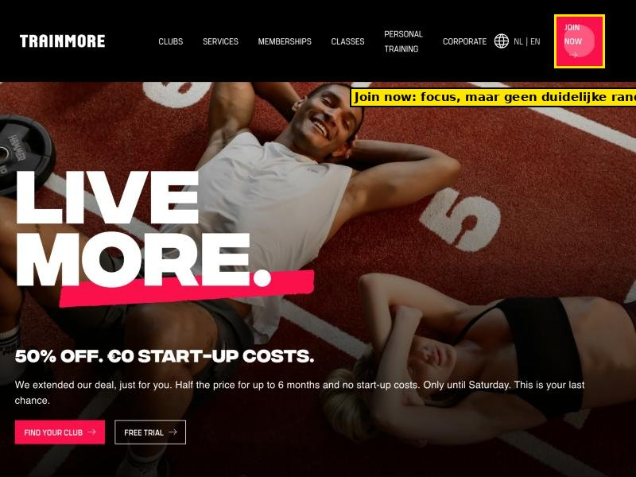
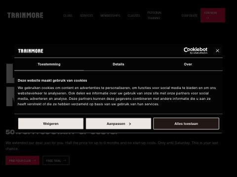
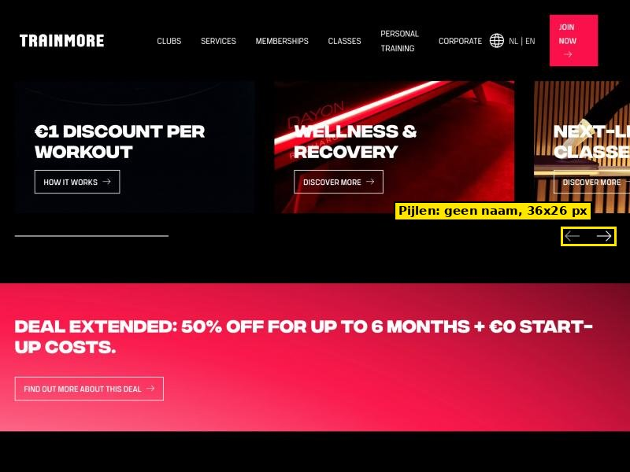
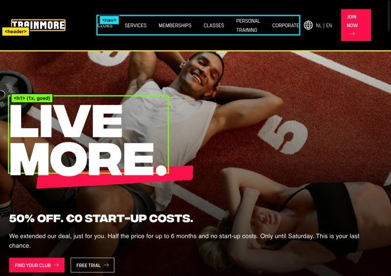

# WCAG-audit van TrainMore

Door Younes El Kharraz, 1 november 2026.

## Inhoudsopgave

* [Inleiding](#inleiding)
* [Lighthouse-test](#lighthouse-test)
  * [Succesvolle tests](#succesvolle-tests)
  * [Handmatige tests](#handmatige-tests)
* [Toetsenbordtest](#toetsenbordtest)
* [Schermlezer-test](#schermlezer-test)
* [Interactieve elementen, kopjes en oriëntatiepunten](#interactieve-elementen-kopjes-en-oriëntatiepunten)
  * [Interactief](#interactief)
  * [Kopteksten en oriëntatiepunten](#kopteksten-en-oriëntatiepunten)
* [Conclusie en verbeterpunten](#conclusie-en-verbeterpunten)
* [Bronnen](#bronnen)

## Inleiding

Voor deze deeltaak heb ik een WCAG-audit gedaan op een bestaande website uit mijn eigen omgeving: de website van sportschool **TrainMore** (https://trainmore.com/en-NL/). Ik heb de homepage in de Engelse versie getest.

Ik heb gebruikt:

- **Lighthouse** (versie 13.6.0, via PageSpeed Insights van Google), desktop.
- Het **toetsenbord** (Tab) om de pagina te bedienen.
- De **ontwikkelaarstools** van de browser om de HTML te controleren.
- De [checklist van The A11Y Project](https://www.a11yproject.com/checklist/) als referentie.

## Lighthouse-test

Lighthouse geeft de homepage een score van **92 voor Toegankelijkheid**.

Lighthouse vond 27 geslaagde controles, 33 die niet van toepassing zijn en 10 controles die je handmatig moet doen. Twee dingen zijn mislukt:

1. **Knoppen hebben geen toegankelijke naam.** Lighthouse noemt een knop in de navigatiebalk (`header#main-navigation`). Een schermlezer kondigt zo'n knop alleen aan als "knop", waardoor je niet weet wat hij doet. (WCAG 4.1.2)
2. **De contrastverhouding is niet voldoende.** (WCAG 1.4.3, AA) Dit gaat om de teksten "Join now" en "Find your club", de tekst "Exclusive member discounts with our partner brands" en de footerlinks.

Bij de praktische tips staat ook: "Identieke links hebben hetzelfde doel."

### Contrast

Normale tekst moet een contrastverhouding van minstens 4,5 op 1 hebben. Ik heb de kleuren zelf nagerekend met de formule uit WCAG:

| Tekst | Kleuren | Contrast | Nodig |
| --- | --- | --- | --- |
| "Join now" en "Find your club" (13 px) | wit op #FA104A | 4,01 : 1 | 4,5 : 1 |
| "Exclusive member discounts with our partner brands" (12 px) | grijs #626262 op #212121 | 2,64 : 1 | 4,5 : 1 |
| Footerlinks: "Terms and conditions", "Promotion terms", "Cookie policy", "Privacy policy", "Club rules" (12 px) | grijs #A4A4A4 op wit | 2,49 : 1 | 4,5 : 1 |
| "© 2026 All rights reserved by Urban Gym Group" (16 px) | grijs #A4A4A4 op wit | 2,49 : 1 | 4,5 : 1 |

De footerlinks zijn de belangrijkste: dat zijn de juridische links (privacy, cookies, voorwaarden), en juist die zijn moeilijk te lezen.

### Succesvolle tests

Een aantal geslaagde Lighthouse-controles die ik opvallend vond:

- **Afbeeldingselementen bevatten een `alt`-attribuut.** Alle 75 afbeeldingen hebben er een, en twee zijn bewust leeg (decoratief). Dat klopt ook met mijn eigen telling. (WCAG 1.1.1)
- **Geen enkel element heeft een `tabindex` groter dan 0.** De tabvolgorde wordt dus niet kunstmatig veranderd. (WCAG 2.4.3)
- **Tikdoelen zijn groot genoeg en hebben voldoende ruimte.** De pijlknoppen van de carrousel zijn 36 bij 26 pixels. (WCAG 2.5.8)
- **Het `lang`-attribuut is geldig.** De pagina heeft `lang="en-NL"`. (WCAG 3.1.1)
- **Zoomen is niet uitgezet** in de viewport-instelling. (WCAG 1.4.4)
- **Koppen staan in aflopende volgorde.** (WCAG 1.3.1)

### Handmatige tests

Lighthouse raadt tien controles aan die je zelf moet doen. Hier staat wat ik daarvan heb gedaan:

| Handmatige controle van Lighthouse | Mijn resultaat |
| --- | --- |
| Interactieve elementen zijn met het toetsenbord te bedienen | Geslaagd voor het menu. Zie de toetsenbordtest. |
| De pagina heeft een logische tabvolgorde | Geslaagd voor het menu en de eerste knoppen. |
| De visuele volgorde volgt de volgorde in de HTML | Geslaagd voor het menu. |
| De focus zit niet vast in een gebied | Niet getest. |
| HTML5-oriëntatiepunten worden gebruikt | Gedeeltelijk, zie "Kopteksten en oriëntatiepunten". |
| Controles over ARIA en eigen bediening | Niet getest. Wij gebruiken geen ARIA in de opdracht. |

Wat ik daarnaast zelf vond:

**Alt-teksten.** De meeste zijn goed, bijvoorbeeld "Red light therapy bed". Maar sommige zeggen niets, zoals de bestandsnaam `NexLevelClasses_desktop.webp`. Ook staan er alt-teksten als `logo` en `Partner logo 9` op de pagina, en de tekst "opent in een nieuw venster", die niet de afbeelding beschrijft. (WCAG 1.1.1)

## Toetsenbordtest

Ik heb met Tab door de pagina gelopen, vanaf het laden van de pagina.

**Volgorde.** De eerste Tab gaat naar het logo. Daarna komt het menu in de volgorde waarin je het ziet: Clubs, Services, Memberships, Classes, Personal training, Corporate, taalkeuze en daarna "Join now" (de negende Tab). Dat is logisch.

**Geen skip-link.** Er is geen "Ga naar de inhoud"-link. Een toetsenbordgebruiker moet bij elk bezoek eerst door het hele menu heen. (WCAG 2.4.1)

**Focus bij het menu.** Bij de menulinks is de focus goed zichtbaar: een oranje rand. (WCAG 2.4.7)

**Focus bij "Join now".** Bij de rode knop "Join now" krijg ik geen duidelijke rand. De pagina toont alleen een vage lichtere cirkel in de knop, en de browser meldt bij deze knop `outline: none`. Een toetsenbordgebruiker ziet dus lastig dat hij op de knop staat. (WCAG 2.4.7)

**Cookiebanner.** Bij het openen verschijnt een cookiebanner. Die is Nederlands, terwijl de pagina Engels is.

Niet getest: of de focus vast kan komen te zitten in een menu of pop-up, en de tabvolgorde van de rest van de pagina.

## Schermlezer-test

Een echte schermlezer (zoals VoiceOver op de Mac) heb ik niet gebruikt. Wat ik wel weet uit de Lighthouse-test en mijn controle van de HTML:

- Een schermlezer leest bij een knop zonder naam alleen "knop" voor (zie Lighthouse).
- Bij afbeeldingen leest een schermlezer de alt-tekst voor. Bij `NexLevelClasses_desktop.webp` is dat dus een bestandsnaam.

**Nog te doen met VoiceOver:** zet VoiceOver aan (Cmd+F5), ga naar de pagina en vraag de lijst met oriëntatiepunten en koppen op. Noteer welke knoppen alleen "knop" zeggen.

## Interactieve elementen, kopjes en oriëntatiepunten

### Interactief

- **Pijlknoppen van de carrousel.** Dit zijn knoppen met alleen een pijl-icoon, zonder tekst. Ik vond er 4 (twee per carrousel). Een schermlezer kan niet zeggen waar ze voor dienen. (WCAG 4.1.2)

  

  Let op: Lighthouse noemt een andere knop in de navigatiebalk. De pijlknoppen heb ik zelf gevonden bij het scrollen. Controleer ze nog in DevTools.
- **"Join now" en "Find your club".** Dit zijn links die eruitzien als knoppen. Het contrast is te laag (zie hierboven) en "Join now" heeft geen duidelijke focusrand.
- **Identieke links.** Lighthouse waarschuwt dat links met dezelfde tekst naar hetzelfde doel moeten gaan.
- **Aanraakdoelen.** De knoppen zijn groot genoeg, ook de pijlknoppen (36 bij 26 px).

### Kopteksten en oriëntatiepunten

**Koppen.** De pagina heeft één `h1` ("LiveMore.") en daaronder `h2` en `h3` koppen in een logische volgorde. (WCAG 1.3.1)

**Oriëntatiepunten.** In de HTML vond ik `header`, meerdere `nav`-elementen en `footer`.

Over `<main>` spreken mijn resultaten elkaar tegen: mijn eigen controle in de browser vond geen `<main>` en geen `role="main"`, maar Lighthouse zegt dat het document wel een hoofdoriëntatiepunt heeft. Dit moet ik nog nakijken in DevTools (tabblad Elements, zoek op `<main`).

## Conclusie en verbeterpunten

De homepage van TrainMore scoort **92 voor toegankelijkheid** in Lighthouse. Op veel punten is de pagina goed: alle afbeeldingen hebben een alt-tekst, de koppen staan in de juiste volgorde, de tabvolgorde is logisch en het menu heeft een zichtbare focus.

De belangrijkste problemen:

1. **Te laag contrast**, vooral de footerlinks (2,49 : 1) en de rode knoppen (4,01 : 1).
2. **Knoppen zonder naam**, zoals de pijlen van de carrousels.
3. **Geen duidelijke focusrand bij "Join now".**
4. **Geen skip-link.**
5. **Alt-teksten** die een bestandsnaam of een onduidelijke tekst zijn.

Verbeterpunten:

1. Maak de footertekst donkerder, bijvoorbeeld #6B6B6B op wit (dat haalt 5,3 : 1), en maak de rode knop donkerder of de tekst groter en vetter.
2. Zet tekst in de carrouselknoppen, bijvoorbeeld "Vorige" en "Volgende", naast het pijltje.
3. Geef de knop "Join now" een duidelijke focusrand, bijvoorbeeld `outline: 3px solid` in een contrasterende kleur.
4. Voeg een "Ga naar de inhoud"-link toe als eerste element en zet de hoofdinhoud in een `<main>`.
5. Schrijf voor elke afbeelding een beschrijving in de taal van de pagina, en geef logo's de naam van het merk.

## Bronnen

- [WCAG 2.2](https://www.w3.org/TR/WCAG22/)
- [The A11Y Project checklist](https://www.a11yproject.com/checklist/)
- [PageSpeed Insights (Lighthouse)](https://pagespeed.web.dev/)
