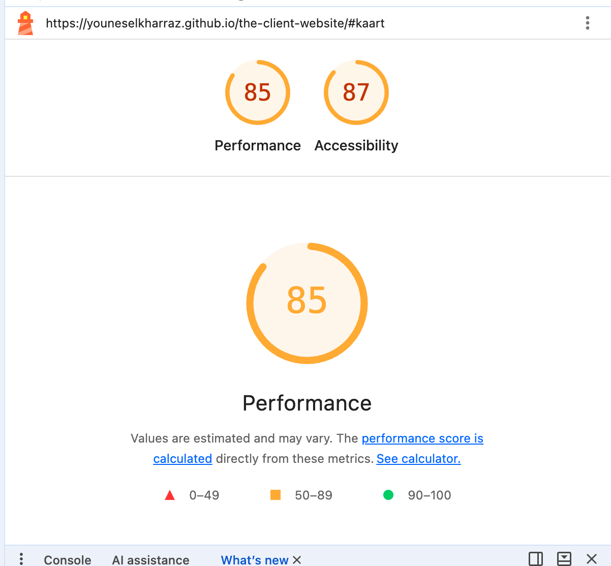
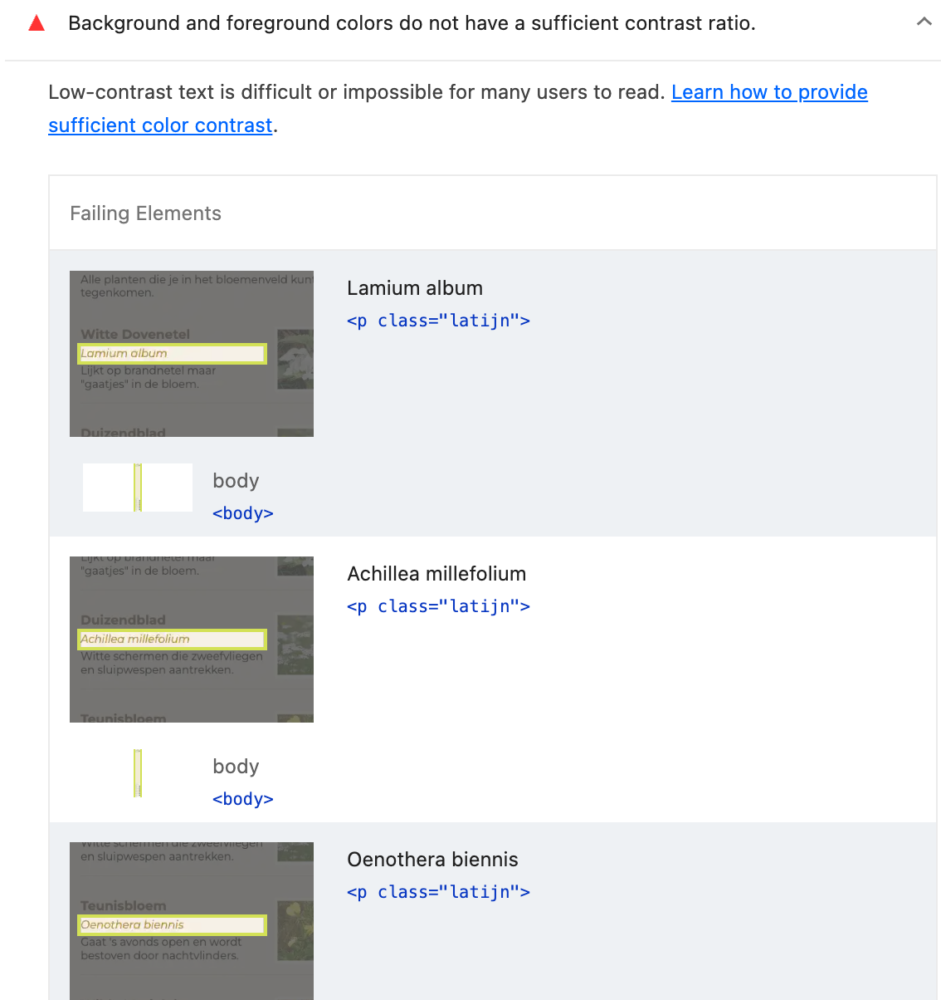
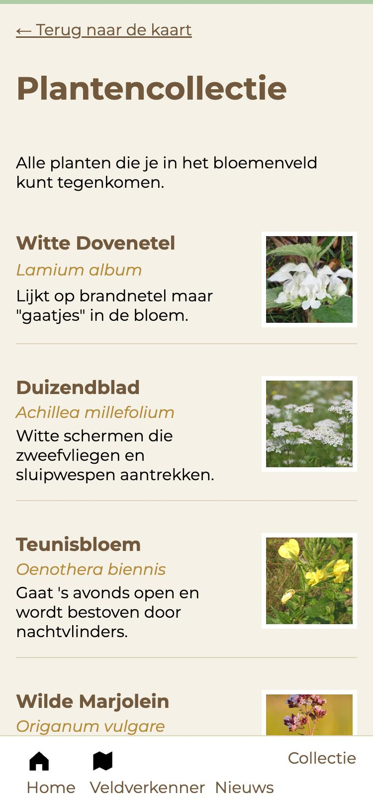
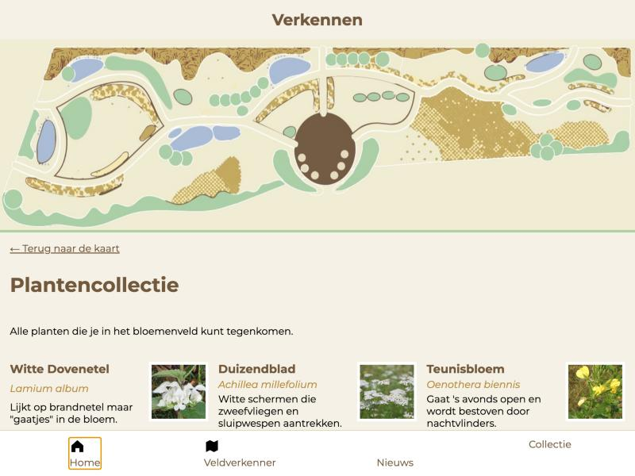
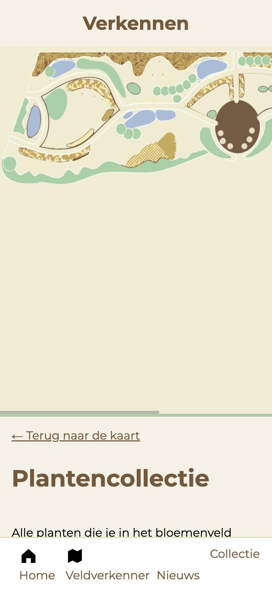

# WCAG-audit van de Veldverkenner


## Inhoudsopgave

* [Inleiding](#inleiding)
* [Lighthouse-test](#lighthouse-test)
  * [Succesvolle tests](#succesvolle-tests)
  * [Handmatige tests](#handmatige-tests)
* [Toetsenbordtest](#toetsenbordtest)
* [Schermlezer-test](#schermlezer-test)
* [Interactieve elementen, kopjes en oriëntatiepunten](#interactieve-elementen-kopjes-en-oriëntatiepunten)
  * [Interactief](#interactief)
  * [Kopteksten en oriëntatiepunten](#kopteksten-en-oriëntatiepunten)
* [Conclusie en verbeterpunten](#conclusie-en-verbeterpunten)
* [Bronnen](#bronnen)

## Inleiding

Voor deze deeltaak heb ik een WCAG-audit gedaan op mijn eigen website: de **Veldverkenner** voor Bloemenveld Frankendael (https://youneselkharraz.github.io/the-client-website/). De pagina heeft twee delen: een kaart van het bloemenveld ("Verkennen") en een plantencollectie.

Ik heb gebruikt:

- **Lighthouse** in de ontwikkelaarstools van Chrome.
- Het **toetsenbord** (Tab) om de pagina te bedienen.
- De **ontwikkelaarstools** van de browser om de HTML en CSS te controleren.
- De [checklist van The A11Y Project](https://www.a11yproject.com/checklist/) als referentie.

## Lighthouse-test

Lighthouse geeft de pagina een score van **87** voor Toegankelijkheid en **85** voor Performance.



Eén controle is mislukt:

- **De contrastverhouding is niet voldoende.** (WCAG 1.4.3, AA) Dit gaat om de Latijnse plantnamen (`<p class="latijn">`), zoals *Lamium album*, *Achillea millefolium* en *Oenothera biennis*.



### Contrast

Normale tekst moet een contrastverhouding van minstens 4,5 op 1 hebben. Grote tekst (vanaf 24 px, of 18,5 px en vet) moet minstens 3 op 1 hebben. Ik heb de kleuren uit mijn CSS zelf nagerekend met de formule uit WCAG:

| Tekst | Kleuren | Contrast | Nodig |
|---|---|---|---|
| Latijnse namen, bijvoorbeeld "Lamium album" (16 px, cursief) | `--goud-donker` #B58A38 op `--papier` #F5F1E6 | 2,80 : 1 | 4,5 : 1 |
| Kop "ALLE PLANTEN" (24 px, vet) | #B58A38 op #F5F1E6 | 2,80 : 1 | 3 : 1 |
| Plantnamen (h3), "Plantencollectie" (h1), "Terug naar de kaart" | `--bruin` #72583C op #F5F1E6 | 5,86 : 1 ✓ | 4,5 : 1 |
| Menu onderin | #72583C op wit | 6,61 : 1 ✓ | 4,5 : 1 |
| Gewone tekst | zwart op #F5F1E6 | 18,61 : 1 ✓ | 4,5 : 1 |

Het probleem zit dus in één kleur: `--goud-donker`. Die gebruik ik voor de Latijnse namen én voor de kop "Alle planten". Lighthouse noemt alleen de Latijnse namen, maar de kop heeft hetzelfde probleem.



### Succesvolle tests

Een aantal geslaagde controles die ik opvallend vond:

- **Afbeeldingselementen bevatten een alt-attribuut.** Alle 21 afbeeldingen hebben er een. Bij de planten is dat de naam van de plant, bijvoorbeeld "Witte dovenetel". (WCAG 1.1.1)
- **Het lang-attribuut is geldig.** De pagina heeft `lang="nl"` en de tekst is Nederlands. (WCAG 3.1.1)
- **De pagina heeft een duidelijke titel:** "Veldverkenner – Bloemenveld Frankendael". (WCAG 2.4.2)
- **Zoomen is niet uitgezet** in de viewport-instelling. (WCAG 1.4.4)
- **Geen enkel element heeft een tabindex.** De tabvolgorde wordt dus niet kunstmatig veranderd. (WCAG 2.4.3)
- **Geen `outline: none` in mijn CSS.** De focusrand van de browser blijft zichtbaar. (WCAG 2.4.7)
- **Tikdoelen zijn groot genoeg.** De links in het menu onderin zijn 49 px hoog. (WCAG 2.5.8)

### Handmatige tests

Lighthouse raadt een aantal controles aan die je zelf moet doen. Hier staat wat ik daarvan heb gedaan:

| Handmatige controle van Lighthouse | Mijn resultaat |
|---|---|
| Interactieve elementen zijn met het toetsenbord te bedienen | Geslaagd. Alle 5 links zijn met Tab te bereiken. |
| De pagina heeft een logische tabvolgorde | Geslaagd. Zie de toetsenbordtest. |
| De visuele volgorde volgt de volgorde in de HTML | Geslaagd. |
| De focus zit niet vast in een gebied | Geslaagd. Er zijn geen pop-ups of menu's waar je in vast kan komen. |
| HTML5-oriëntatiepunten worden gebruikt | Gedeeltelijk, zie "Kopteksten en oriëntatiepunten". |
| Controles over ARIA en eigen bediening | Niet van toepassing. Ik gebruik geen ARIA. |

## Toetsenbordtest

Ik heb met Tab door de pagina gelopen, vanaf het laden van de pagina.

**Volgorde.** De eerste Tab gaat naar "← Terug naar de kaart". Daarna komt het menu onderin: Home, Veldverkenner, Nieuws en Collectie. Dat is logisch.

**Focus.** Bij elke link is de focus goed zichtbaar: de browser tekent een rand om de link. (WCAG 2.4.7)



**Geen skip-link.** Er is geen "Ga naar de inhoud"-link. Op deze pagina is dat niet echt een probleem: het menu staat onderaan, dus je komt met Tab meteen bij de inhoud. (WCAG 2.4.1)

**Kapotte links.** De links "Home" (`home.html`) en "Nieuws" (`nieuws.html`) geven een 404-foutmelding. Deze pagina's bestaan nog niet.

**De kaart.** De kaart is alleen een afbeelding. Je kunt er met het toetsenbord niets op aanklikken. Op een telefoon moet je de kaart zijwaarts scrollen, en onder de kaart staat een groot leeg vlak.



Niet getest: of je de kaart op een telefoon met het toetsenbord zijwaarts kunt scrollen.

## Schermlezer-test

Een echte schermlezer (zoals VoiceOver op de Mac) heb ik niet gebruikt. Wat ik wel weet uit mijn controle van de HTML:

- Bij de afbeeldingen leest een schermlezer de naam van de plant voor. Dat is goed.
- Bij de kaart leest hij alleen "Kaart van het bloemenveld" voor. Iemand die de kaart niet kan zien, weet dan nog niet wat erop staat.
- De titel "Verkennen" staat niet in de HTML, maar komt uit de CSS (`content: "Verkennen"`). Daardoor is het geen echte kop en kan een schermlezer er niet naartoe springen.
- In het menu onderin zitten iconen (`<svg>`) zonder tekst. De links hebben wel tekst ("Home", "Veldverkenner"), dus de schermlezer leest de goede naam voor.

Nog te doen met VoiceOver: zet VoiceOver aan (Cmd+F5), ga naar de pagina en vraag de lijst met koppen en oriëntatiepunten op (VO + U).

## Interactieve elementen, kopjes en oriëntatiepunten

### Interactief

De pagina heeft 5 interactieve elementen, allemaal links. Er zijn geen knoppen of formulieren.

| Link | Gaat naar | Resultaat |
|---|---|---|
| ← Terug naar de kaart | `#kaart` | Werkt |
| Home | `home.html` | 404, pagina bestaat niet |
| Veldverkenner | `#kaart` | Werkt |
| Nieuws | `nieuws.html` | 404, pagina bestaat niet |
| Collectie | `#collectie` | Werkt |

- **Iconen in het menu.** Home en Veldverkenner hebben een icoon. Bij Nieuws is de `<svg>` leeg en bij Collectie ontbreekt het icoon. Daardoor staat "Collectie" hoger dan de andere menu-items.
- **"Terug naar de kaart"** is maar 20 px hoog. Hij is wel breed, maar op een telefoon is hij lastiger aan te tikken dan het menu. (WCAG 2.5.8 vraagt minstens 24 bij 24 px)

### Kopteksten en oriëntatiepunten

**Koppen.** De pagina heeft één h1 ("Plantencollectie"). Daarna komen meteen h3-koppen (de plantnamen) en pas daarna de h2 "Alle planten". Er wordt dus een niveau overgeslagen: van h1 naar h3. (WCAG 1.3.1)

```
h1  Plantencollectie
  h3  Witte Dovenetel      ← h2 ontbreekt hierboven
  h3  Duizendblad
  ...
  h2  Alle planten
    h3  Teunisbloem
    ...
```

**Oriëntatiepunten.** In de HTML vond ik:

- `<main>` voor de plantencollectie ✓
- `<nav>` voor het menu onderin ✓
- Elke plant staat in een `<article>` ✓
- **Geen `<header>`.** De kaart met de titel "Verkennen" staat in een gewone `<div>`, buiten de `<main>`.
- **Geen `<footer>`.** Die is op deze pagina ook niet nodig.

## Conclusie en verbeterpunten

De Veldverkenner scoort 87 voor toegankelijkheid in Lighthouse. Op veel punten is de pagina goed: alle afbeeldingen hebben een alt-tekst, de taal is goed ingesteld, de focus is zichtbaar en de tabvolgorde is logisch.

De belangrijkste problemen:

1. **Te laag contrast** bij de Latijnse namen en de kop "Alle planten" (2,80 : 1).
2. **Twee kapotte links** in het menu (Home en Nieuws).
3. **Een overgeslagen kopniveau** (van h1 naar h3).
4. **De titel "Verkennen"** staat alleen in de CSS en is geen echte kop.
5. **De alt-tekst van de kaart** is erg kort.

Verbeterpunten:

- **Contrast:** maak `--goud-donker` donkerder. Met #7D5A1C haal je 5,55 : 1, en dat is genoeg.

  ```css
  :root {
    --goud-donker: #7d5a1c;
  }
  ```

- **Kapotte links:** maak `home.html` en `nieuws.html` aan, of haal de links weg tot de pagina's klaar zijn.
- **Koppen:** zet een h2 boven de eerste zes planten, bijvoorbeeld `<h2>Uitgelicht</h2>`. Dan is de volgorde h1, h2, h3.
- **Titel "Verkennen":** zet hem in de HTML als echte kop, bijvoorbeeld `<header><h2>Verkennen</h2></header>` boven de kaart, en haal `content` uit de CSS.
- **Kaart:** schrijf een langere alt-tekst die zegt wat er op de kaart staat, bijvoorbeeld "Kaart van het bloemenveld met paden, vijvers, bloemvakken en in het midden een rond plein".
- **Menu:** geef Nieuws en Collectie ook een icoon, zodat alle items op dezelfde hoogte staan.

## Bronnen

- [WCAG 2.2](https://www.w3.org/TR/WCAG22/)
- [The A11Y Project checklist](https://www.a11yproject.com/checklist/)
- [Lighthouse in Chrome DevTools](https://developer.chrome.com/docs/lighthouse/overview)
- [Understanding WCAG 2.2 – Contrast (Minimum)](https://www.w3.org/WAI/WCAG22/Understanding/contrast-minimum.html)
